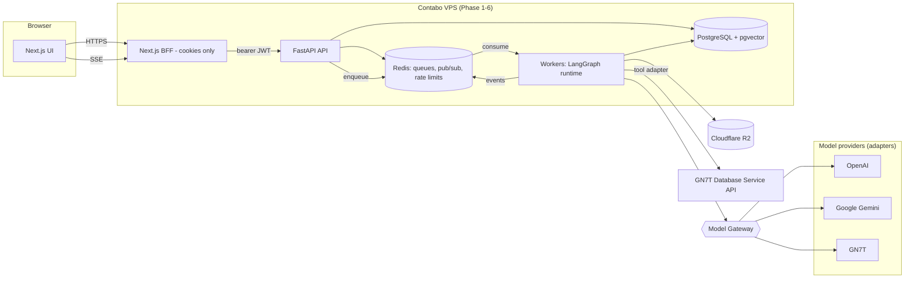
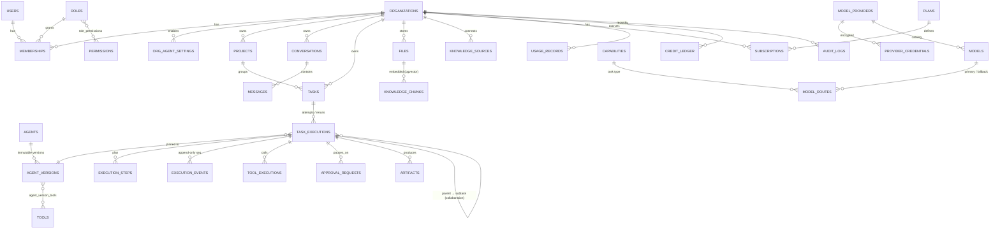
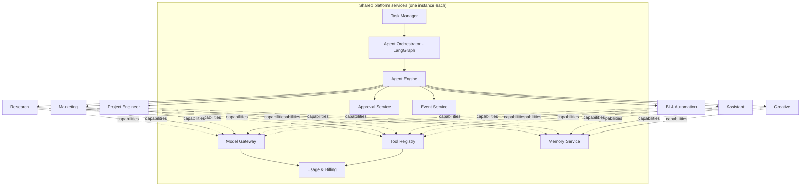

# AgentFirm — Architecture & Phase-1 Plan

> Status: **v0.9** (Phases 1–7 delivered; launch steps in `docs/ops/launch-checklist.md`) · Owner: platform team · Last updated: 2026-11-17
> Scope: answers the nine "First Task" items of the master brief, plus the super-admin
> **per-task model routing** requirement (Gemini / OpenAI / GN7T).

---

## 0. Repository inspection — findings

The working environment contained **no existing AgentFirm repository** (no source, no git history,
no GN7T client code). Consequences:

* This repo is a fresh monorepo. Nothing was migrated.
* The GN7T integration "built earlier" is **not available here**. Its API contract must be supplied
  before the `gn7t` provider adapter can be implemented (see Risks R-1). Phase 1 represents it only
  in admin UI demo data.
* Toolchain found: Node 22, npm 10, Python 3.13. Frontend scaffolded on **Next.js 16.4**
  (App Router, `cacheComponents` enabled by default), **Tailwind CSS 4.3**, React 19.3.

---

## 1. Proposed project structure

A **modular monolith**: one FastAPI deployable + one worker deployable built from the same Python
package, one Next.js app. Module boundaries are enforced by import rules (each module exposes a
`service.py` façade; other modules may not import its `models.py`/`repository.py` directly).

```
agentfirm/
├── web/                          # Next.js 16 (App Router, strict TS, Tailwind 4)
│   └── src/
│       ├── app/
│       │   ├── (app)/            # authenticated workspace shell
│       │   │   ├── page.tsx      # Overview (dashboard)
│       │   │   ├── agents/  collaboration/  tasks/  projects/  knowledge/
│       │   │   ├── conversations/  history/  notifications/
│       │   │   └── billing/  integrations/  settings/
│       │   ├── (admin)/admin/    # super-admin area (separate shell + server-side guard)
│       │   │   └── models/       # provider + per-task model routing
│       │   └── api/              # BFF route handlers (auth callback, SSE proxy)
│       ├── components/
│       │   ├── ui/               # design-system primitives (Button, Card, Badge, Progress…)
│       │   ├── agent/            # AgentActivityCore, AgentCard, AgentGlyph
│       │   ├── tasks/            # TaskCard, ExecutionTimeline
│       │   ├── shell/            # Sidebar, Topbar, ThemeToggle, WorkspaceSwitcher
│       │   └── charts/
│       ├── lib/
│       │   ├── api/              # typed client generated from FastAPI OpenAPI
│       │   ├── events/           # SSE subscription hooks (useExecutionStream)
│       │   └── theme/
│       └── mocks/                # ⚠ demo data ONLY — never imported by lib/api
├── api/                          # Python 3.13, FastAPI, SQLAlchemy 2, Alembic
│   ├── agentfirm/
│   │   ├── core/                 # settings, db session, tenancy context, crypto, logging
│   │   ├── modules/
│   │   │   ├── identity/         # users, orgs, memberships, roles, permissions
│   │   │   ├── agents/           # agent definitions + immutable versions
│   │   │   ├── conversations/    # conversations, messages
│   │   │   ├── tasks/            # Task Manager: tasks, executions, steps, events
│   │   │   ├── orchestrator/     # LangGraph graphs (single-agent + multi-agent)
│   │   │   ├── gateway/          # Model Gateway, routing policy, provider adapters
│   │   │   │   └── providers/    # openai.py gemini.py gn7t.py (behind Protocol)
│   │   │   ├── tools/            # Tool Registry, tool executions, sandboxing policy
│   │   │   ├── memory/           # conversation/user/project memory (pgvector)
│   │   │   ├── knowledge/        # files, chunking, embeddings, retrieval
│   │   │   ├── approvals/        # Approval Service
│   │   │   ├── billing/          # usage records, credits, plans, limits
│   │   │   ├── events/           # Event Service (persist → Redis pub/sub → SSE)
│   │   │   ├── audit/            # append-only audit log
│   │   │   └── admin/            # super-admin APIs (models, agents, tools, pricing)
│   │   ├── integrations/         # GN7T DB service client, R2 storage client
│   │   ├── api/                  # FastAPI routers (thin; call module services)
│   │   └── workers/              # queue consumers, recovery sweeper, schedulers
│   ├── alembic/
│   └── tests/                    # unit, integration (testcontainers), tenancy, evals/
├── infra/                        # docker-compose (pg+pgvector, redis), Caddy, deploy scripts
└── docs/
    ├── ARCHITECTURE.md           # this file
    ├── adr/                      # one ADR per major decision
    └── agents/                   # six agent specs + shared Agent Interface spec (pre-Phase 4)
```

---

## 2. Architecture overview



**Request lifecycle for a task**

1. UI → `POST /v1/tasks` with an `Idempotency-Key`.
2. Task Manager writes `task` + `task_execution(status=queued)` in one transaction, plus an
   outbox row; the outbox relay pushes the job onto a Redis Stream.
3. A worker claims the job (consumer group, `XCLAIM` on stale), loads the **pinned agent version**,
   resolves models via the Gateway routing policy, and runs the LangGraph graph with a
   **Postgres checkpointer** (so a crashed worker resumes from the last node, not from zero).
4. Every node transition, tool call, model call, approval request and artifact is written to
   `execution_events` (monotonic `seq` per execution) **then** published on Redis pub/sub.
5. `GET /v1/executions/{id}/events` (SSE) replays from Postgres using `Last-Event-ID`, then tails
   pub/sub. Refreshing the browser, navigating away or losing the network loses nothing.

**Why this shape (implications)**

| Decision | Implication |
|---|---|
| Modular monolith | One deploy, one DB, cheap on a single VPS. Module seams (service façades + events) let us split the worker/gateway later without rewriting callers. |
| Persist-then-publish events | Postgres is the source of truth; Redis loss only drops live fan-out, never history. Slightly higher write volume — mitigated by batching token-stream events (see §6). |
| LangGraph + Postgres checkpointer | Durable, resumable graphs and native human-in-the-loop `interrupt()` for approvals. We accept LangGraph as a core dependency and pin its version. |
| FastAPI owns sign-in; the Next.js BFF only stores tokens in httpOnly cookies (ADR 0001) | Browser JavaScript never sees tokens or provider keys; one auth authority to audit. We own reset/MFA/SSO flows (R-11–R-13). |

---

## 3. Frontend design system

Implemented in `web/src/app/globals.css` as CSS variables mapped into Tailwind 4 `@theme`.
Themes are switched with `data-theme` on `<html>`, set by an inline pre-paint script
(no flash), persisted in `localStorage("af-theme")`, defaulting to `prefers-color-scheme`.

**Color tokens**

| Token | Dark | Light | Use |
|---|---|---|---|
| `--bg` | `#090B12` | `#F5F7FC` | app canvas |
| `--bg-2` | `#101421` | `#FFFFFF` | sidebar, header |
| `--card` | `#141A29` | `#FFFFFF` | surfaces |
| `--border` | `#252D40` | `#E5E9F2` | hairlines |
| `--accent` | `#648BFF` | `#536FFF` | primary actions, focus |
| `--accent-2` | `#A77BFF` | `#8765E8` | secondary accent, collaboration |
| `--cyan` | `#48D9E8` | `#0FA5B8`* | live activity highlight |
| `--fg` | `#F1F4FC` | `#182033` | primary text |
| `--fg-2` | `#929CB2` | `#68738A` | secondary text |
| status | ok `#34D399` · warn `#F5B94A` · err `#F2667A` | ok `#0F9F6E` · warn `#B7791F` · err `#D6455C` | statuses |

\* Light-theme cyan is darkened from the brief's dark value to keep ≥ 3:1 contrast on white.
Light mode is designed separately: solid white cards with soft shadow + 1px border instead of
glass, accents de-saturated slightly, glows replaced by tinted fills.

**Type**: Geist Sans (UI) / Geist Mono (IDs, metrics, %, timestamps). Scale: 12 / 13 / 14 / 16 /
20 / 28 / 36. Weights limited to 400 / 500 / 600.

**Shape & depth**: radius 10 (controls) / 14 (cards) / 20 (hero). Glass only on the header and
hero (`backdrop-blur` 12px, 70% surface alpha). Glow reserved for **live** state (working,
collaborating) so it carries meaning.

**Motion**: 150–250 ms ease-out for UI; the agent core uses slow loops (4–12 s). All loops stop
under `prefers-reduced-motion` (CSS media query + `useReducedMotion()`).

**Status vocabulary** (shared by cards, badges, cores): `available · working · waiting_approval ·
paused · completed · failed` (+ `collaborating` for the core only).

---

## 4. Main application navigation

```
WORKSPACE      Overview · My Agents · Agent Collaboration · Tasks & Runs · Projects · Knowledge & Files
ACTIVITY       Conversations · History · Notifications
MANAGEMENT     Usage & Billing · Integrations · Settings
ADMIN*         Models & Routing · Agents · Tools · Pricing · Organizations · Audit · System health
```
\* Visible only to platform `super_admin`; **enforced server-side** (route guard + API checks),
not by hiding links.

Top bar: breadcrumbs/title · global search (⌘K) · **New Task** · notifications · theme toggle ·
profile menu. Sidebar collapses to an icon rail (≥1024px) or a drawer (<1024px).

---

## 5. Core database entity relationships

All tenant-owned tables carry `org_id NOT NULL`. Platform-owned tables (providers, model catalog,
agent definitions, tools, plans) have no `org_id` and are writable only by super-admins.



Key constraints:
* **Composite tenant FKs**: child tables reference `(org_id, id)` of their parent, so a task in
  org A can never point to a project in org B, even through an application bug.
* `execution_events (execution_id, seq)` unique; events are never updated or deleted.
* `agent_versions` are immutable after `published_at`; executions reference a version id, which
  makes every past run traceable to the exact instructions/tools/models used (§21.9).
* `usage_records` and `credit_ledger` are append-only; balances are derived, never edited.
* `audit_logs` append-only; the DB role used by the app has no `UPDATE/DELETE` grant on it.

### 5.1 Per-task model routing (super-admin requirement)

Super-admins choose **which provider/model handles each kind of work**, with ordered fallbacks.

```
capabilities          id, key, label            -- reasoning, text, code, summarize, classify,
                                                --   embeddings, vision, long_context, creative
model_providers       id, key (openai|gemini|gn7t), base_url, status, adapter_version
provider_credentials  id, provider_id, ciphertext, key_id, created_by, rotated_at  -- never returned
models                id, provider_id, model_name, capabilities[], ctx_window,
                      price_in_per_1m, price_out_per_1m, status
model_routes          id, scope (platform|plan|org|agent_version), scope_id,
                      capability_id, priority (0 = primary, 1.. = fallbacks),
                      model_id, params jsonb (temperature, max_tokens, reasoning_effort),
                      constraints jsonb (max_cost, data_residency, require_zdr)
```

**Resolution order** (first match wins): agent-version override → org override (only if the
org's plan allows BYO routing) → plan default → platform default. The Gateway then walks the
priority list, skipping providers whose circuit breaker is open, and records the **actual** model
used on every `usage_record`. Every routing change writes an `audit_logs` row with before/after.

Agents declare *capabilities*, not model names, e.g. the Research agent asks the Gateway for
`reasoning` while planning and `summarize` while condensing sources. That is what makes the
admin choice apply "for any task".

---

## 6. Agent execution architecture



* **Agents are data + a graph, not prompts.** An `AgentVersion` = manifest (mission, scope,
  intents, input/output schemas, capability needs, tool allow-list, limits, approval policy) +
  a registered LangGraph sub-graph key. Six agents share one engine; adding a seventh means a new
  manifest and (optionally) a new sub-graph — no shell or engine changes.
* **Shared capabilities** (Brainstorming Engine, Research & Retrieval, Document Processing,
  Planning, Web Search, Code Execution, Data Analysis) are registered tools/sub-graphs with
  permission checks, so Marketing can invoke the Brainstorming Engine without duplicating it.
* **Collaboration** = orchestrator graph: `analyze → plan (DAG of subtasks) → assign → fan-out
  (child executions) → join → verify → synthesize`. Each child is a real `task_execution` with
  `parent_execution_id`, so the UI collaboration graph is rendered from data.
* **Progress semantics (no fake percentages).** `progress` is `null` until a plan exists. Once a
  plan with N steps exists, `progress = completed_weight / total_weight` and is emitted only on
  step completion events. If a step's internal progress is unknown, the UI shows an
  indeterminate bar for that step. Plan revisions emit `plan.updated` and may lower progress;
  the UI shows that honestly.
* **Approvals.** Tools are tagged `side_effect: none|internal|external|financial|destructive`.
  Policy (agent + org + tool) decides `auto | require_approval | deny`. A required approval calls
  LangGraph `interrupt()`, persists an `approval_request`, emits `approval.requested`, and the
  execution sits in `waiting_approval` until a user with `approvals:decide` responds.
* **Pause / resume / cancel**: cooperative. The worker checks status and lease ownership at
  every node start; a paused execution resumes from its last checkpoint.
* **Idempotency**: API `Idempotency-Key` on create. Tool executions are keyed
  `execution:step:tool:n`, so a resumed graph never double-sends. Step outputs are committed
  atomically with `step.completed`, so a recorded step is restored, never re-run (ADR 0003).
* **Implementation (Phase 4a):** `api/agentfirm/runtime/` holds `engine.py` (graph build/run),
  `context.py` (the only door to models/tools), `gateway/` (adapters, simulator), `tools/`
  (runtime enforcement, implementations, SSRF-guarded web) and `programs/` (one per agent). The
  worker lives in `api/agentfirm/worker.py`; see ADR 0003 for leases, checkpoints and simulated mode.
* **Phase 4b:** `runtime/connectors/` (GitHub, signed webhooks, SMTP, GN7T data, OSV, sandbox; a
  deterministic fixture world for dev/CI), `runtime/tools/analysis.py` (declarative pandas analysis —
  numbers are computed, never generated), `runtime/tools/charts.py` (SVG charts + table view) and
  `runtime/schedules.py` (report schedules run by the worker). Approval-gated tools run under the
  **approver's** authority (ADR 0004). The web app reads live data through the BFF in the browser and
  derives run state from the SSE event log (`web/src/lib/events/`).
* **Phase 5 — orchestrator** (`runtime/orchestrator.py`, ADR 0005): a task with several agents (or none
  selected) starts an orchestrator execution that plans a validated subtask graph, runs each subtask as an
  ordinary agent execution, hands results downstream as untrusted data, follows agent handoffs under
  policy and writes one combined result. It has no tools; approvals stay per subtask. Spec:
  `docs/agents/orchestrator.md`.
* **Phase 6 — monetization & governance** (ADR 0006): `modules/billing/accounts.py` (plans, two-bucket
  credit balance, server-side limits), `modules/billing/paddle.py` + `subscriptions.py` (Paddle Billing:
  server-created checkout transactions, signed webhooks as the only source of truth, fixture mode),
  `modules/governance/` (standing approvals, tool kill-switch, super-admin platform API), and
  `POST /v1/tasks/{id}/reply` to resume a task that asked a question.
* **Event types** (v1): `execution.status`, `plan.created|updated`, `step.started|completed|failed`,
  `tool.called|result`, `model.called` (+ batched `token.delta`), `approval.requested|resolved`,
  `artifact.created`, `subtask.spawned|completed`, `progress`, `log`.

---

## 7. Multi-tenant security approach

1. **Identity** (ADR 0001): the Python API is the only identity authority — argon2id
   passwords, lockout after repeated failures, Redis-backed rate limits, and sessions stored
   server-side.
2. **Tokens**: the API issues 10-minute EdDSA access tokens bound to a session, plus opaque
   14-day refresh tokens that rotate on every use (replaying an old one revokes the session).
   The Next.js BFF keeps both in httpOnly cookies and checks the Origin header on state-changing
   calls. FastAPI re-loads the session and the membership on every request.
3. **Tenant context**: a FastAPI dependency builds `TenantContext(org_id, user_id, permissions)`.
   Repositories require it as a parameter; there is no un-scoped query helper in module code.
4. **Defense in depth — Postgres RLS** on every tenant table:
   `USING (org_id = current_setting('app.org_id')::uuid)`, set with `SET LOCAL` per transaction.
   A forgotten `WHERE` still returns nothing from another org.
5. **RBAC**: org roles `owner · admin · member · viewer` → permission strings
   (`tasks:create`, `approvals:decide`, `billing:manage`, …). Platform `super_admin` is a separate
   flag on `users`, checked by a separate dependency, and every admin request is audit-logged.
6. **Secrets**: provider keys encrypted with AES-256-GCM using a data key wrapped by a master key
   from the environment (KMS later). Admin APIs return only `last4` + metadata. Workers decrypt
   in-memory at call time.
7. **Files**: R2 objects keyed `org/{org_id}/…`; downloads via short-lived presigned URLs issued
   only after an authorization check.
8. **Agent safety**: tool allow-lists per agent version, side-effect classification + approval
   policy, untrusted content (web pages, files, tool output) wrapped and never allowed to change
   tool permissions; outbound network allow-lists for code execution sandboxes.
9. **Rate limiting & quotas**: Redis token buckets per user, org and provider; credit checks
   before execution start and between steps.
10. **Tests**: a tenancy test suite that creates two orgs and asserts every endpoint returns
    404 for cross-org ids (generated from the OpenAPI schema so new endpoints are covered).

---

## 8. Development roadmap

| Phase | Deliverables | Exit criteria |
|---|---|---|
| **1 — Foundation & design system** ✅ | Tokens, dark/light themes, app shell, AgentActivityCore, dashboard, admin model-routing screen (demo data) | `next build` clean, strict TS, both themes, responsive, reduced-motion respected |
| **2 — Frontend application** ✅ | Agent directory, agent workspace (3-panel), task monitor, collaboration view, creative idea board, usage, settings | All screens on typed mock adapters behind `lib/api` interfaces |
| **3 — Backend foundation** ✅ | FastAPI, SQLAlchemy models + Alembic, Python sign-in (ADR 0001), RLS (ADR 0002), RBAC, audit log, admin model routing API, tenancy test suite | 66 tests green incl. cross-tenant suite; OpenAPI → TS types generated |
| **3.5 — Agent specifications** ✅ | Six agent specs + shared Agent Interface spec (`docs/agents/`), executable manifests, tool catalog, 91 eval cases, version publish/rollback | Registry invariants + doc/schema drift checks green; **awaiting product sign-off** |
| **4a — Agent Engine** ✅ | Model Gateway (OpenAI, Gemini, GN7T adapters; model-list import; fallback; circuit breaker; credits), Tool Registry runtime, DB-leased workers, LangGraph engine with Postgres checkpoints + approval interrupts, SSE, knowledge/ideas/memory APIs, Creative + Research agents, eval harness (ADR 0003) | ✅ Kill-worker-mid-run test resumes without re-running steps; eval baseline 29/29 machine checks (`docs/evals/`) |
| **4b — Live screens & agents** ✅ | Live data + SSE in the web app, Knowledge and Integrations screens, connectors + fixture world, Marketing, Engineer, BI, Assistant programs, report schedules, LLM judge for rubric items (ADR 0004) | ✅ 91/91 machine checks across six agents (simulated + fixture); browser end-to-end runs without mocks; 194 API tests |
| **5 — Collaboration** ✅ | Orchestrator (validated subtask DAG, budgets, handoffs, synthesis), subtask approvals, pause/cancel cascade, live Collaboration page and subtask graph (ADR 0005) | ✅ 12/12 multi-agent eval cases (simulated); approval gates hold inside collaborations (tests + evals); 204 API tests |
| **6 — Admin & monetization** ✅ | Plans & credit ledger, Paddle Billing (checkout, signed webhooks, portal, invoices, top-ups), super-admin plans/pricing/workspaces/agents/tools, standing approvals, reply-to-resume (ADR 0006) | ✅ Every admin mutation audit-logged (tests); credits, seats, concurrency and plan agents enforced server-side; 221 API tests; browser end-to-end in Paddle fixture mode |
| **7 — Production readiness** ✅ | Security review and fixes, JSON logs + Prometheus metrics + alerts + Grafana, encrypted backups to R2 with restore drill, Locust load test and SLOs, production compose + Caddy, VPS provisioning, CI and health-gated deploy with rollback, master-key rotation (ADR 0007) | ✅ Restore drill passed; p95 SLOs met in the sandbox (100 users, 0 errors); 234 API tests; 103/103 simulated eval cases. ⏳ External pen test and the first real-VPS deploy are launch steps, not done here |

---

## 9. Risks and unresolved decisions

| # | Item | Impact | Proposed handling |
|---|---|---|---|
| R-1 | **GN7T contract unknown here.** The brief calls GN7T a *Database Service*; the latest request lists it as an *AI provider*. Code built earlier is not in this workspace. | Can't implement adapter | **Assumption:** GN7T exposes an inference API usable as a model provider *and* a separate data API used as a tool. Need its OpenAPI spec, auth scheme and streaming format. |
| R-2 | ~~Tea-800 API contract unknown~~ | — | **Resolved:** Tea-800 was removed from the platform. |
| R-3 | Single Contabo VPS = single point of failure | Downtime, data loss | **Phase 7:** encrypted `pg_dump` to R2 every 6 h (RPO 6 h, RTO 1 h), restore drilled, external uptime check required at launch. Availability target 99.5 %. WAL archiving is *not* built (see R-30). |
| R-4 | ~~Auth.js maintenance~~ | — | **Resolved:** sign-in moved to the Python API (ADR 0001). |
| R-5 | Billing provider not specified (Stripe? Paddle? local?) | Phase 6 design | Decide before Phase 6; ledger is provider-agnostic. |
| R-6 | Web search / email / calendar providers for agents not specified | Agent capability gaps | Choose per capability in agent specs (Phase 3.5). |
| R-7 | Token-stream event volume in Postgres | DB write load | Persist batched `token.delta` (≈250 ms windows); full text persisted once in `messages`. |
| R-8 | Can org admins override platform model routing? | Product/pricing | Default **no**; plan-gated "Bring your own model routing" in Phase 6. |
| R-9 | Data residency / zero-retention requirements per provider | Compliance | `constraints.require_zdr` on routes; flag providers in catalog. |
| R-11 | Password reset & email verification not built yet | Account recovery | Needs an email provider; add signed, single-use, 30-min reset tokens (Phase 6–7). |
| R-12 | No MFA yet (still open after Phase 7) | Account takeover | Mitigated for super-admin pages by the Caddy IP allowlist. TOTP first, WebAuthn next; require for super-admins, then owners/admins. |
| R-13 | No SSO / social login | Enterprise adoption | OIDC via Authlib in the API when needed. |
| R-14 | Simulated model mode could be mistaken for real output | Trust | Labelled on every event and usage row; production refuses non-live modes; eval reports state it. |
| R-15 | DNS-rebinding TOCTOU in `web.fetch` | SSRF to internal services | Pre-connect IP checks today; route agent egress through a filtering proxy on the VPS. **Not built in Phase 7**; open. |
| R-16 | Retrieval is keyword-only (OR-ranked since 4b) | Recall on paraphrased questions | pgvector embeddings via an `embeddings` capability route (Phase 5). |
| R-17 | Rubric items need live models | Quality unmeasured in CI | Judge built (`harness --judge`, `reasoning` route); runs only with live models, so CI reports rubric items as *pending*. Run before release. |
| R-18 | Docker sandbox untested here (no daemon) | Engineer test runs unproven in production | Only the command line is unit-tested. Run on a dedicated sandbox host (rootless Docker/gVisor); never mount the host Docker socket. Compose ships `disabled`. |
| R-19 | No native OAuth connectors (Google/Microsoft calendar & mail, LinkedIn, Meta Ads) | Setup friction | Signed webhook bridge (n8n/Zapier/Make) until native connectors in Phase 6. |
| R-20 | GN7T data API contract assumed (`/v1/datasets`, `/v1/query`) | BI live mode may need adapter changes | Confirm with the GN7T team; the adapter is one file (`connectors/services.py`). |
| R-21 | Webhook DNS-rebinding between check and connect | SSRF | Same handling as R-15 (egress proxy, Phase 7); addresses are re-checked on every call. |
| R-22 | ~~Recurring automations approve once per run~~ | — | **Resolved (Phase 6):** standing approvals (conditions, use limit, ≤ 90-day expiry, creator authority re-checked, never destructive tools). |
| R-23 | A subtask can "complete" with no useful output (e.g. Research finds no sources) and still release its dependents | Downstream work built on nothing | The approval preview catches external actions today. Proposal: agents report `partial` + `no_answer` quality flag, and the orchestrator asks before continuing. Needs product decision. |
| R-24 | ~~Answering a subtask's question doesn't resume the task~~ | — | **Resolved (Phase 6):** reply-to-resume; orchestrated tasks reuse finished subtasks. |
| R-26 | Paddle integration verified only in fixture mode here (no sandbox account) | Field names or flows may differ in production | Run the sandbox checklist in README (subscribe, upgrade, top-up, cancel, failed payment) before launch; webhook events are logged with errors for super-admins. |
| R-27 | Prices, Paddle price IDs and the default payment link aren't set | Nothing is for sale until configured | Owner decision: set them in Platform → Plans; approve the checkout domain in Paddle. |
| R-28 | Annual plans: allowance still resets monthly | Pricing model gap | Decide whether annual plans get 12× allowance up front or monthly; model it before selling annual. |
| R-29 | Web CSP allows `script-src 'unsafe-inline'` (Next.js partial prerender inline scripts) | XSS defence weaker than a nonce/hash CSP | All user/model content is rendered as text; artifacts are served sandboxed. Revisit when Next supports PPR hashes, or nonce dynamic routes. |
| R-30 | No point-in-time recovery (WAL archiving) | Up to 6 h of data lost in a disaster | Add WAL-G/pgBackRest to R2 once paying customers depend on it; repeat the drill. |
| R-31 | External penetration test not yet done; Phase 7 was verified in a sandbox (no Docker daemon, no VPS, Paddle in fixture mode, simulated models) | Unknowns at first real deploy | Launch checklist: first deploy, restore drill and load test repeated on the real server, external pen test before customers. |
| R-25 | Orchestrator planning quality is unmeasured in CI | Wrong agent mix in live use | Simulated planner proves machinery only; run the orchestrator suite with `--judge` and live models before release. |
| R-10 | Next.js 16 `cacheComponents` changes rendering defaults | Dev friction | Keep time-dependent/user-dependent UI in client components or behind `<Suspense>`. |

Assumptions made in Phase 1 (cheap to change): Geist fonts, Motion for animation, custom
theme script instead of `next-themes`, `/admin` as a sibling route group of the workspace.
