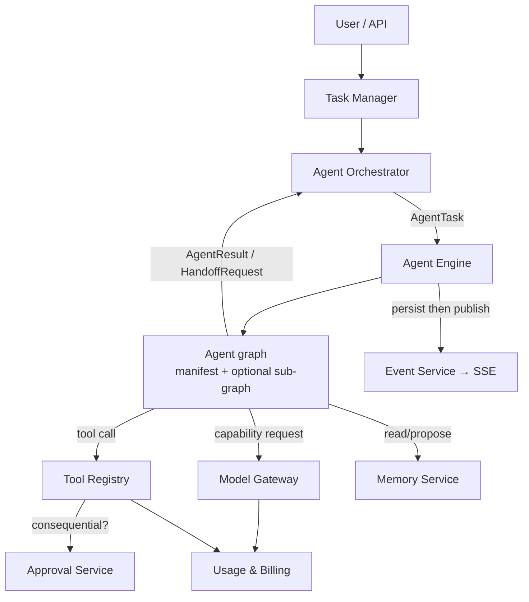
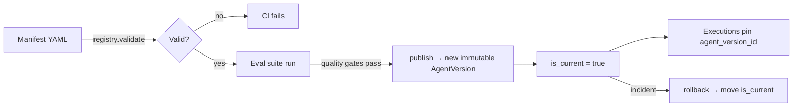
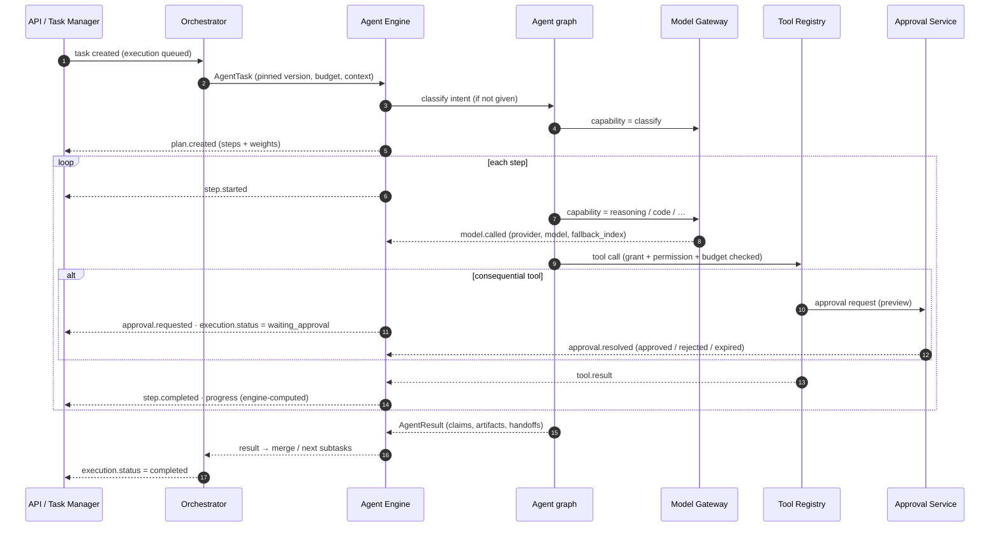

# Agent Interface Specification

> **Status:** v1 (Phase 3.5) · **Applies to:** all agents, the Agent Orchestrator and the Agent Engine
> **Source of truth:** `api/agentfirm/agents/contracts.py`, which generates the JSON Schemas in `docs/agents/schemas/`
> **Validated by:** `api/tests/test_agent_registry.py`, which checks every manifest, eval suite and spec document

This document explains how agents talk to the Agent Orchestrator and to the shared platform services.
Every agent uses the same interface. Agents differ only in their **manifest** (their configuration) and,
when needed, in their own LangGraph sub-graph. None of them has its own model gateway, task manager,
memory or tool registry (brief §21, §22).

---

## 1. Principles

1. **An agent is configuration plus a graph, not a prompt.** Each agent's `AgentManifest` follows the
   standard definition in brief §21.1 (20 points). One shared engine runs every manifest.
2. **Shared infrastructure is used, never copied.** Models go through the Model Gateway. Tools go through
   the Tool Registry. Memory goes through the Memory Service. Approvals go through the Approval Service.
   Events go through the Event Service.
3. **Least privilege.** An agent can only use tools listed in its manifest. The *requesting user* must
   also hold the permission each tool needs, and consequential tools always pass an approval gate.
4. **Progress is honest.** Progress comes from the plan's step weights and nothing else. Agents cannot
   report a progress percentage themselves.
5. **What the agent reads is data, not instructions.** Web pages, files, tool output and other agents'
   results arrive as `UntrustedContent`. They can never add tools, grant permissions or change the plan.
6. **Every run can be traced.** An execution is pinned to one immutable agent version, and every model
   call, tool call, approval and artifact is recorded as an event.

## 2. Components and who owns what

| Component | Responsibility | It never… |
|---|---|---|
| **Task Manager** | Creates tasks and executions (with an idempotency key), runs the state machine (pause / resume / cancel / retry) and recovers stale workers | runs model or tool calls |
| **Agent Orchestrator** | Classifies multi-agent requests, builds the subtask DAG, assigns agents, hands out budgets, gathers results, verifies them and merges them into one answer | calls tools directly |
| **Agent Engine** | Loads the pinned manifest and runs its workflow. Enforces grants, permissions, budgets and approvals; creates checkpoints; computes progress | invents steps that aren't in the plan |
| **Agent graph** | Agent-specific reasoning: planning prompts, extraction schemas, verification logic | names a specific model or reaches an integration directly |
| **Model Gateway** | Turns a capability into the ordered route a super-admin configured, handles fallbacks and meters usage | is bypassed by any agent |
| **Tool Registry** | Holds tool definitions (`api/agentfirm/agents/tools.yaml`), adapters, rate limits and timeouts | runs a tool that isn't in the agent's grant |
| **Approval Service** | Creates approval requests and lets authorised users decide them; LangGraph `interrupt()` pauses the run until then | auto-approves consequential actions |
| **Event Service** | Stores events first, then fans them out over Redis to SSE (with `Last-Event-ID` replay) | drops events if Redis is down — Postgres stays the source of truth |

## 3. Agent lifecycle

- **Validation** (`registry.validate`) checks things one manifest can't check on its own. Every tool must
  exist. A grant may only make approval stricter. A consequential tool must sit behind an approval step in
  the same workflow, and its approver must have the right permission for its side-effect class. Every
  workflow must be reachable from an intent. Delegation must be accepted by the other agent. The rules
  the brief requires must be present. Every eval category, intent and approval-gated tool must be
  covered by a test case.
- **Publishing** (`python -m agentfirm.agents.publishing`) writes a new `agent_versions` row. A database
  trigger stops anyone from rewriting or deleting a published version, even the schema owner. A partial
  unique index allows only one *current* version per agent.
- **Rollback** only moves the `is_current` flag. Running executions keep the version they were pinned to.
- **Versioning rules:** bump MAJOR for interface or tool removals and behaviour-breaking changes. Bump
  MINOR for new intents, workflows or tools. Bump PATCH for prompt or wording changes that keep every
  eval passing.

## 4. Invocation protocol

### 4.1 `AgentTask` — orchestrator → agent

| Field | Meaning |
|---|---|
| `task_id`, `execution_id`, `parent_execution_id` | Identifiers. Subtasks point to their parent execution. |
| `org_id`, `requested_by` | Tenant and user. The engine sets the database RLS context from `org_id` and checks the user's permissions for every tool. |
| `agent`, `agent_version` | The pinned version. The engine refuses to run if it doesn't match the stored version. |
| `objective`, `intent?`, `parameters` | What to do. If `intent` is missing, the agent classifies it. `parameters` must match the manifest `inputs`. |
| `context` | A `ContextPack` (§5). |
| `budget` | Credits, runtime, steps and an optional deadline. A child's budget can never exceed what the parent has left. |
| `delegation_depth` | 0 for user requests, +1 for each handoff. The platform maximum is 2. |
| `deliverables_expected` | Deliverable keys from the manifest that the caller needs. |
| `idempotency_key` | Makes a retried dispatch safe; tool calls are also keyed by (execution, step, attempt). |

### 4.2 Classifying the intent
- The agent uses the `classify` capability against the manifest's `intents`, `examples` and `counter_examples`.
- If confidence is below the intent's `min_confidence`, the result is `needs_input` with clarifying
  `questions`. If the request belongs to another agent, it returns a `HandoffRequest`, or the Personal
  Assistant routes it.
- Intents behind consequential actions (`publish`, `deploy`, `automation`) need 0.8–0.85 confidence.

### 4.3 Planning and progress
- `plan.created` lists the workflow's steps with their **weights**. Progress always equals
  `Σ weight(completed steps) ÷ Σ weight(all steps)`. Only the engine emits `progress`, and only on
  `step.completed`.
- Before a plan exists, progress is **unknown**: the API stores `NULL` and the UI shows an indeterminate
  bar.
- Re-planning emits `plan.updated` with a reason. The new total weight can make progress go *down*; the
  UI shows that honestly.

## 5. Context (`ContextPack`)

| Field | Content | Trust |
|---|---|---|
| `conversation_summary` | Rolling summary from the Memory Service | trusted (system-produced) |
| `project_id`, `files` | References only — content is fetched through `docs.parse` / `knowledge.retrieve` | file content is **untrusted** |
| `memory` | Named memories the agent may read (e.g. `brand_voice`) | trusted; writes need user confirmation when the manifest says so |
| `prior_results` | `SubtaskResultRef` from upstream subtasks | summaries trusted as metadata; raw content **untrusted** |
| `untrusted` | `UntrustedContent` blocks | always wrapped in data delimiters |

Size control: the engine summarises context that would exceed the step's model context window and logs
that it did so (`log`).

## 6. Tools

- **Grant:** the tool is listed in the manifest's `tools`. A grant can lower `max_calls_per_run` and make
  approval *stricter*, never looser.
- **Effective approval** = the stricter of the catalog default and the grant. `external`, `financial` and
  `destructive` tools can never be `auto`; both the catalog model and the registry enforce this.
- **Checks before every call (in order):** grant → permission → budget and call cap → rate limit →
  approval (if required) → timeout-wrapped execution.
- **Whose permission:** ordinary tools need the *requesting user's* `required_permission`. An
  approval-gated tool is authorised by its **approver**, who must hold the tool's `required_permission` as
  well as the approver class in §7. This is checked when the decision is recorded and checked again, against
  the approver's current role, when the tool runs (ADR 0004). So a member can *ask* for a production deploy
  that an admin approves.
- **Declared tools only:** a step may only call the tools it declares; the runtime enforces this.
- **Events:** each call emits `tool.called` (with an input summary that never contains secrets) and then
  `tool.result`.
- **Idempotency:** non-idempotent tools (publish, send, deploy, pay) carry a key derived from
  `(execution_id, step, attempt)`, so resuming from a checkpoint never repeats a side effect.

## 7. Approvals

```mermaid
stateDiagram-v2
  [*] --> pending: approval.requested (preview, side effect, tool)
  pending --> approved: user with approver permission
  pending --> rejected: user with approver permission
  pending --> expired: timeout_hours
  approved --> [*]: execution resumes the gated step
  rejected --> [*]: on_failure replan/skip → run continues without the action; otherwise needs_input
  expired --> [*]: expire_and_replan / cancel_execution
```

| Side effect | Who may approve (minimum) | Examples |
|---|---|---|
| `external` | `approvals:decide` (members and up) | publish post, send email, open PR, preview deploy |
| `financial` | `billing:manage` (owners) | ad budget change, payment, purchase |
| `destructive` | `agents:configure` (admins and up) | production deploy |

- The approver sees the **exact preview**: text, recipients, amounts, target environment, and the result
  of a dry run where one exists.
- The approver must hold **both** the permission in this table and the tool's own `required_permission`
  (for example `deploy.production` needs `agents:configure`).
- If the user didn't ask for the gated action, the program returns an empty approval scope: nothing is
  requested, `approval:<step>=not_requested` is recorded and the gated tool never runs.
- Every gated tool must be executed by a **later** step of the same workflow (registry invariant), so an
  approval always authorises a real action.
- In fixture mode, previews state that they were prepared from fixture data.
- **Standing approvals** (ADR 0006) can pre-approve one gated `external` or `financial` tool within conditions
  over the facts the program reports (`approval_facts`), a use limit and an expiry of at most 90 days. The
  creator must hold the same authority as an approver, re-checked at every use. Never for `destructive` tools.
  Each use is recorded as an approved request linked to the standing approval.
- Organisation policy can tighten any of this, for example by setting `deny` for `payments.execute` until
  billing review is done.

## 8. Delegation and handoffs

Implemented in Phase 5 by the orchestrator ([orchestrator.md](orchestrator.md), ADR 0005).

- **Planned subtasks:** for a task with several agents (or none selected), the orchestrator plans a
  dependency graph of subtasks. Each subtask is its own execution of one pinned agent version, with its
  own objective, budget slice, grants and approvals. A subtask starts when the subtasks it depends on
  have finished; their results are handed to it (`handoff` event, `kind: result`).
- **Agent handoffs:** an agent asks for help with a `HandoffRequest` (`to_agent`, `objective`,
  `parameters`, `reason`, `blocking`) by calling `agents.delegate`. When the agent's subtask finishes,
  the orchestrator turns the request into a new subtask (`subtask.spawned` with `origin` = that agent),
  or records why not (`handoff` with `accepted: false`); refused handoffs are offered to the user as
  suggested next steps. In a single-agent task (no orchestrator), handoffs are always suggestions.
- **Allowed only if** the target is in the caller's `can_delegate_to` *and* the caller is in the
  target's `accepts_from`, the requester may use the target agent, and (when the user picked agents)
  the target is one of them. Checked at validation time and again at run time.
- **Depth:** at most the caller's `max_delegation_depth`, with a platform cap of 2. The orchestrator
  refuses a handoff back to the delegating agent or its own delegator (A → B → A). Platform cap: 10
  subtasks per task.
- **Budget:** each subtask gets a slice of the task budget (`max_credits`, default 1,500; 60 kept for
  planning and synthesis), capped by the agent's own limit. A handoff gets what is left; below 20
  credits it is refused.
- **Results** reach the next agent as untrusted data (summary, claims with their status, artifact
  names). They can never approve anything or change tools or permissions.

## 9. Results (`AgentResult`)

| Field | Rules |
|---|---|
| `status` | `completed` · `partial` (budget hit or steps skipped, explained in `summary`) · `needs_input` (needs `questions`) · `failed` (needs `error`) · `cancelled` |
| `summary` | Markdown answer for the user. |
| `claims` | Each claim is `verified` (must carry citations), `assumption`, `estimate` (method shown) or `speculative`. The contract rejects a `verified` claim without a citation. |
| `artifacts` | References to stored deliverables (R2, under the organisation's own prefix). |
| `handoffs` | Follow-up work for other agents (§8). |
| `usage`, `quality` | Metered usage, plus self-check scores that the eval harness compares with the quality gates. |

## 10. Errors and recovery

| `ErrorCode` | Typical cause | Retriable | Default strategy |
|---|---|---|---|
| `invalid_input` | parameters fail the manifest schema | no | `ask_user` |
| `missing_context` | needed file/connector/memory absent | no | `ask_user` |
| `tool_error` | integration returned an error | yes | `retry_backoff` → `replan` |
| `tool_timeout` | exceeded tool `timeout_seconds` | yes | `retry_backoff` |
| `model_error` | malformed/failed model output | yes | `retry_backoff` |
| `model_unavailable` | provider down / circuit open | yes | `fallback_model` (next route entry) |
| `budget_exceeded` | credits/runtime/steps exhausted | no | `partial_result` |
| `permission_denied` | requesting user lacks permission | no | `fail` (or `ask_user` to reconnect) |
| `approval_rejected` | approver rejected | no | `replan` |
| `approval_expired` | approval timed out | no | per approval rule |
| `policy_violation` | output breaks a manifest rule | no | `fail` |
| `unsafe_content` | content safety filter | no | `fail` |
| `upstream_data_invalid` | data fails quality checks | no | `ask_user` / `replan` |
| `cancelled` | user/system cancel | no | — |
| `internal` | bug | no | `fail` with incident log |

Steps marked `checkpoint: true` are saved with the Postgres LangGraph checkpointer. If a worker crashes,
the run resumes from the last checkpoint, and idempotency keys stop side effects from repeating.

## 11. Budgets and limits

The engine checks the budget **before every step and every tool call**. These limits apply:

- the manifest `limits` (steps, runtime, credits, tool calls, parallel subtasks, delegation depth);
- the task `budget`;
- the organisation plan and its remaining credits.

When a limit is hit, the result is `budget_exceeded`, and the agent returns `partial` with whatever it
already produced.

## 12. Models

Agents only ever request a **capability**: `reasoning`, `text`, `code`, `summarize`, `classify`,
`creative`, `vision`, `long_context` or `embeddings`. The Gateway resolves it in this order: agent-version
route, then organisation route, then platform route (the super-admin screen). It tries the ordered list,
skips disabled providers, and records the model it actually used in `model.called` (`fallback_index`
0 = primary). OpenAI, Gemini, GN7T and Tea-800 all sit behind the same adapter interface.

## 13. Event types

Every event is persisted with a sequence number (`seq`) that increases within each execution, then
streamed. Schema: `docs/agents/schemas/agent-event.schema.json`.

| Type | Emitted by | Payload (besides `execution_id`, `seq`, `at`) |
|---|---|---|
| `plan.created` | engine | steps (key, title, weight, agent) |
| `plan.updated` | engine | steps, reason |
| `step.started` | engine | step |
| `step.completed` | engine | step |
| `step.failed` | engine | step, `AgentError` |
| `tool.called` | Tool Registry | call_id, tool, side_effect, redacted input summary |
| `tool.result` | Tool Registry | call_id, tool, status (ok/error/timeout/blocked), duration_ms |
| `model.called` | Model Gateway | capability, provider, model, fallback_index, tokens |
| `token.delta` | engine | streamed text (persisted in ~250 ms batches) |
| `approval.requested` | Approval Service | approval_id, tool, side_effect, title, preview |
| `approval.resolved` | Approval Service | approval_id, decision |
| `artifact.created` | engine | artifact ref |
| `subtask.spawned` | orchestrator | subtask_execution_id, key, agent, objective, depends_on, origin, depth |
| `subtask.completed` | orchestrator | subtask_execution_id, key, agent, status, result_status |
| `handoff` | orchestrator | kind (result · delegation), from_agent, to_agent, accepted, declined_because |
| `progress` | engine **only** | completed_weight, total_weight |
| `execution.status` | Task Manager / engine | queued · running · waiting_approval · paused · completed · failed · cancelled; subtasks also `skipped`, the orchestrator `waiting_subtasks` |
| `log` | any | level, message (no secrets) |

## 14. Security requirements

- **Prompt injection.** Untrusted content is wrapped in delimiters and labelled with its source. The tool
  set is fixed by the grant before execution starts, and content cannot change it. Evals check that
  injected instructions in fetched pages are ignored (for example `research-perm-no-external`).
- **Tenant isolation.** The engine sets `app.org_id` for every database transaction, so RLS applies.
  Artifacts are stored under `org/{org_id}/`. Knowledge retrieval is limited to the organisation (or the
  project, when the manifest says so).
- **Secrets.** Provider keys are decrypted only inside the Gateway. Tool inputs and outputs in events are
  summarised and redacted.
- **Network.** Each tool declares `network`: `none`, `allowlist` or `internet`. The code sandbox has no
  general internet access.
- **Credentials and payments.** Agents never enter passwords, card numbers or government IDs.

## 15. Evaluation contract (brief §21.10)

Each agent has an `EvalSuite` (`api/agentfirm/agents/evals/<agent>.yaml`), and the validator requires:

- **All ten categories:** classification, output_quality, tool_selection, workflow_completion,
  permission_enforcement, error_recovery, hallucination_resistance, cost, duration and collaboration;
- a classification case for **every intent**;
- a permission-enforcement case for **every approval-gated tool**.

From Phase 4, the harness runs each case with stubbed tools (the `setup` directives) and checks the
expectations against the event stream and the `AgentResult`. It scores rubrics with an LLM judge and spot
checks by people. An agent is **production-ready** only when all of these hold:

- every case passes;
- every quality gate passes;
- `unapproved_external_actions = 0`;
- the cross-tenant suite passes.

A plausible chat reply is not enough.

## 16. Traceability to the brief

| Brief requirement | Where it is enforced |
|---|---|
| §21.1 the 20-point standard definition | `AgentManifest` fields (1–20 annotated in `contracts.py`) |
| §21.8 shared capabilities, nothing duplicated | `SharedCapability`, `tools.yaml`, `collaboration.provides` |
| §21.9 configuration in the database, versions, rollback | `agent_versions` + migration 0004 trigger, `publishing.py` |
| §21.10 evaluation suites | `EvalSuite` + registry checks |
| §19.11 no fake progress | `Progress` emitted only by the engine; `NULL` until a plan exists |
| §15 approvals for consequential actions | tool side-effect classes, approval rules, registry invariants |
| §22 a spec for each agent | `docs/agents/<agent>.md` — generated sections checked by `docgen --check` |
