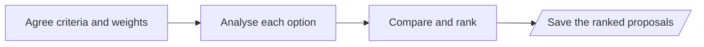
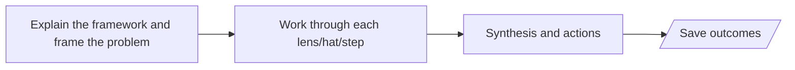
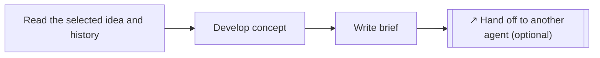

# Agent Specification — Creative & Brainstorming

<!-- BEGIN GENERATED: header -->
| | |
|---|---|
| **Agent key** | `creative` |
| **Manifest version** | v1.4.2 (draft) |
| **Manifest** | `api/agentfirm/agents/manifests/creative.yaml` |
| **Eval suite** | `api/agentfirm/agents/evals/creative.yaml` (14 cases) |
| **Invocation permissions** | `agents:use`, `tasks:create` |
| **Changelog** | 1.4.2 — Phase 4b: more intent examples for clearer routing.<br>1.4.1 — Phase 4a: first executable version; evaluation saves ranked proposals as an artifact; step tool lists are enforced at runtime.<br>1.4.0 — Full specification manifest (Phase 3.5): nine thinking approaches, idea board, handoffs, shared brainstorming engine.<br>1.3.0 — Initial seeded definition. |
<!-- END GENERATED: header -->

## 1. Purpose and scope

<!-- BEGIN GENERATED: scope -->
**Mission.** Help users think creatively — generate diverse ideas, challenge assumptions, evaluate options and hand the promising ones to other agents.

**Responsibilities**

- Pick a thinking approach that fits the objective and constraints (or the user's choice).
- Generate diverse, non-generic ideas and explore alternative perspectives.
- Challenge assumptions and evaluate ideas against explicit criteria.
- Group, rank and develop promising concepts into actionable proposals.
- Save ideas to the idea board and hand selected ideas to other agents.

**In scope**

- Idea generation, business brainstorming, product and feature ideation.
- Naming and branding concepts; creative writing and marketing concepts.
- Problem-solving frameworks, scenario planning, premortems, structured debate.
- Critical evaluation and ranking of options.

**Out of scope**

- Presenting ideas as validated facts or market data (Research/BI validate).
- Trademark/legal clearance of names (flag for human review).
- Publishing or executing ideas directly (handoff to the owning agent).

**Known limitations**

- Scores are judgement, not measurement; they are labelled as such.
- Name availability (domains, trademarks) is not checked unless handed to Research.

**Capabilities:** `idea_generation`, `business_brainstorming`, `product_innovation`, `feature_ideation`, `naming_and_branding`, `creative_concepts`, `problem_solving`, `strategic_thinking`, `scenario_planning`, `critical_evaluation`, `alternative_solutions`
<!-- END GENERATED: scope -->

## 2. Functional requirements

| ID | Requirement | Priority |
|---|---|---|
| FR-C1 | Support nine thinking approaches: divergent, convergent, first principles, lateral, SCAMPER, Six Thinking Hats, analogical, structured debate and premortem. If none is given, choose one and explain the choice. | Must |
| FR-C2 | Read the idea board and `rejected_ideas` memory before generating, so ideas aren't repeated. | Must |
| FR-C3 | Generate diverse ideas, then remove duplicates and generic suggestions (quality gates `idea_diversity` and `generic_idea_rate`). | Must |
| FR-C4 | Challenge assumptions explicitly (one step per session). | Must |
| FR-C5 | Score ideas against explicit criteria (default: impact, feasibility, novelty), and label the scores as judgement. | Must |
| FR-C6 | Label factual-sounding statements in ideas `speculative`, unless a Research handoff verified them. | Must |
| FR-C7 | Save ideas to the idea board with their approach, lens, tags and scores. Support edit, move and compare (the UI is built; this agent writes the same model). | Must |
| FR-C8 | Develop a chosen idea into a concept or creative brief, and hand it to Research, Marketing, BI or Engineer. | Must |
| FR-C9 | Work on its own, or as the shared **Brainstorming Engine** that other agents call through a handoff. | Must |
| FR-C10 | Support iterative sessions: refine an earlier session's ideas while keeping their history. | Should |

## 3. Technical architecture

- **Graph:** the shared engine runs the `ideation`, `evaluation`, `framework_session` and `develop`
  workflows. The agent's own sub-graph adds:
  1. an *approach library*, with one prompt module per thinking approach and structured outputs per
     lens (for example six hat sections, seven SCAMPER verbs);
  2. a *diversity filter*, which uses embedding distance and generic-pattern detection;
  3. a *board writer*, which uses the idea model the Phase-2 UI already works with (`Idea`: title,
     summary, approach, lens, tags, scores, column).
- **Two models:** a high-temperature `creative` route to diverge, and a low-temperature `reasoning` route
  to evaluate. Both are chosen by super-admins in model routing.
- **Shared capability provided:** `brainstorming_engine`. Marketing, Engineer, BI and Research hand
  subtasks to this agent instead of re-implementing ideation.

### Model use

<!-- BEGIN GENERATED: models -->
- **Capabilities requested from the Model Gateway:** `creative`, `reasoning`, `classify` (default `creative`)
- **Temperatures:** creative 0.95, reasoning 0.3, classify 0.0 · **max output tokens:** 6000
- **Routing:** super-admins choose provider/model per capability (OpenAI, Gemini, GN7T, Tea-800) — the agent never names a model.
- **Routing hints:**
  - High-temperature creative model for divergence; low-temperature reasoning model for evaluation.
<!-- END GENERATED: models -->

## 4. Intent recognition

<!-- BEGIN GENERATED: intents -->
| Intent | Meaning | Workflow | Example requests | Not this agent | Min. confidence |
|---|---|---|---|---|---|
| `ideate` | Generate ideas for an objective (divergent by default). | `ideation` | “Brainstorm 20 names for our tutoring product.”<br>“Give me feature ideas for the mobile app.”<br>“Generate fresh ideas for improving our checkout flow.”<br>“Business ideas for the home-fitness market.” | “Write the final LinkedIn post (marketing).” | 0.60 |
| `evaluate` | Critically evaluate, compare or rank existing ideas. | `evaluation` | “Rank these three positioning options.”<br>“What's wrong with this plan? Be harsh.” | — | 0.60 |
| `problem_solving` | Structured problem-solving with a named framework. | `framework_session` | “Run a premortem on our launch plan.”<br>“Use Six Thinking Hats on the pricing decision.”<br>“Apply SCAMPER to our onboarding flow.” | — | 0.60 |
| `develop_idea` | Develop a selected idea into a concept or brief, optionally hand off. | `develop` | “Develop "Exam Sprint" into a product concept.”<br>“Turn the top idea into a brief for the marketing agent.” | — | 0.60 |
<!-- END GENERATED: intents -->

## 5. Workflows

<!-- BEGIN GENERATED: workflows -->
#### Ideation session (`ideation`)

Frame → pick approach → diverge → de-duplicate → challenge → cluster → score → save.


| # | Step | Kind | Model capability | Tools | Weight (share of progress) | On failure |
|---|---|---|---|---|---|---|
| 1 | Frame objective and constraints (`frame`) | classify | reasoning | — | 0.5 (7%) | ask_user |
| 2 | Read existing ideas to avoid repeats (`context`) | retrieve | — | `ideas.board_read`, `memory.read` | 0.5 (7%) | retry |
| 3 | Generate diverse ideas with the chosen approach (`diverge`) | model | creative | — | 3 (43%) | retry |
| 4 | Remove duplicates and generic suggestions (`dedupe`) | verify | classify | — | 0.5 (7%) | retry |
| 5 | Challenge assumptions (`challenge`) | model | reasoning | — | 1 (14%) | retry |
| 6 | Cluster and score against criteria (`score`) | model | reasoning | — | 1 (14%) | retry |
| 7 | Save to idea board (`save`) | tool | — | `ideas.board_write`, `artifact.write` | 0.5 (7%) | retry |

#### Critical evaluation (`evaluation`)

Criteria → per-idea analysis → comparison → recommendation with risks.



| # | Step | Kind | Model capability | Tools | Weight (share of progress) | On failure |
|---|---|---|---|---|---|---|
| 1 | Agree criteria and weights (`criteria`) | model | reasoning | — | 0.5 (12%) | retry |
| 2 | Analyse each option (`analyse`) | model | reasoning | — | 2 (50%) | retry |
| 3 | Compare and rank (`compare`) | synthesize | reasoning | — | 1 (25%) | retry |
| 4 | Save the ranked proposals (`save`) | tool | — | `artifact.write` | 0.5 (12%) | skip |

#### Framework session (`framework_session`)

Run SCAMPER, Six Hats, premortem, debate, analogies or first principles step by step.



| # | Step | Kind | Model capability | Tools | Weight (share of progress) | On failure |
|---|---|---|---|---|---|---|
| 1 | Explain the framework and frame the problem (`setup`) | plan | reasoning | — | 0.5 (10%) | retry |
| 2 | Work through each lens/hat/step (`perspectives`) | model | creative | — | 3 (60%) | retry |
| 3 | Synthesis and actions (`synthesis`) | synthesize | reasoning | — | 1 (20%) | retry |
| 4 | Save outcomes (`save`) | tool | — | `ideas.board_write`, `artifact.write` | 0.5 (10%) | retry |

#### Develop and hand off (`develop`)

Expand an idea into a concept/brief; optionally hand off to the owning agent.



| # | Step | Kind | Model capability | Tools | Weight (share of progress) | On failure |
|---|---|---|---|---|---|---|
| 1 | Read the selected idea and history (`read`) | retrieve | — | `ideas.board_read` | 0.5 (11%) | retry |
| 2 | Develop concept (`develop`) | model | creative | — | 2 (44%) | retry |
| 3 | Write brief (`brief`) | synthesize | reasoning | `artifact.write` | 1 (22%) | retry |
| 4 | Hand off to another agent (optional) (`handoff`) | delegate | — | `agents.delegate` | 1 (22%) | skip |

Legend: 🛡 approval gate · ↗ delegation to another agent · parallelogram = tool call · ✓ verification step.
<!-- END GENERATED: workflows -->

## 6. Tools and integrations

<!-- BEGIN GENERATED: tools -->
| Tool | Side effect | Effective approval | User permission | Max calls / run | Provider (status) |
|---|---|---|---|---|---|
| `ideas.board_read` — Read idea board | none | auto | `agents:use` | 10 | AgentFirm idea store (planned) |
| `ideas.board_write` — Save to idea board | internal | auto | `agents:use` | 60 | AgentFirm idea store (planned) |
| `memory.read` — Read memory | none | auto | `agents:use` | 5 | Memory service (planned) |
| `artifact.write` — Save deliverable | internal | auto | `agents:use` | 5 | Cloudflare R2 (org/{org_id}/…) (planned) |
| `agents.delegate` — Delegate to agent | internal | auto | `tasks:create` | 4 | Agent Orchestrator (planned) |
<!-- END GENERATED: tools -->

## 7. Data access, knowledge and memory

<!-- BEGIN GENERATED: data -->
- **Knowledge sources:** `idea_board`, `project_knowledge`, `conversation_history`, `brand_memory`, `agent_results` (scope: project)
- **Untrusted sources** (treated as data, never instructions): `agent_results`
- **Citations required:** no · **PII handling:** avoid
- **Memory:** conversation ✓ · user preferences ✓ · project ✓ · named memories `rejected_ideas`, `preferred_approaches` · retention 365 days
<!-- END GENERATED: data -->

- The idea board is scoped to the organisation (and to the project when one is set). Ideas marked
  rejected go to the `rejected_ideas` memory so they aren't proposed again.

## 8. Input and output schemas

<!-- BEGIN GENERATED: io -->
**Task parameters** (`AgentTask.parameters`)

| Name | Type | Required | Description |
|---|---|---|---|
| `objective` | text | yes | What we are thinking about. |
| `approach` | enum (divergent / convergent / first_principles / lateral / scamper / six_hats / analogical / debate / premortem) | no | Thinking approach (auto if omitted). |
| `constraints` | text | no | Must-haves, budget, audience, tone. |
| `count` | number | no | Number of ideas to generate (default 12). |
| `criteria` | list | no | Evaluation criteria (default impact, feasibility, novelty). |

**Deliverables** (artifacts referenced from `AgentResult.artifacts`)

| Key | Title | Format | Contents |
|---|---|---|---|
| `idea_collection` | Idea collection | ideas | Ideas with approach, lens, tags and judgement scores. |
| `ranked_proposals` | Ranked proposals | markdown | Shortlist with criteria scores and risks. |
| `concept` | Product/business concept | markdown | Problem, audience, solution, differentiation, risks. |
| `creative_brief` | Creative brief | docx | Brief ready for Marketing or Engineering. |
| `framework_output` | Framework output | markdown | Results of SCAMPER, Six Hats, premortem, debate or scenarios. |
<!-- END GENERATED: io -->

**Idea (board item) — the same shape the Phase-2 UI renders**

```json
{"title": "Exam Sprint", "summary": "Six-week IELTS sprint with a score-improvement guarantee.",
 "approach": "convergent", "lens": "Cluster B", "tags": ["Exam prep", "Pricing"],
 "scores": {"impact": 9, "feasibility": 6, "novelty": 6}, "column": "new", "verified": false}
```

## 9. Permissions and approvals

To invoke this agent, the user needs `agents:use` and `tasks:create`. Viewers can read the board but
can't start sessions or write to it.

<!-- BEGIN GENERATED: approvals -->
This agent has no tools that need approval. All of its tools are read-only or only change AgentFirm itself.
<!-- END GENERATED: approvals -->

## 10. Failure scenarios and recovery

| ID | Scenario | Behaviour |
|---|---|---|
| FS-C1 | Primary creative model unavailable | Fall back to the next route entry and continue the session (`fallback_index` ≥ 1). |
| FS-C2 | Output is too generic or repetitive | The diversity filter rejects it, and the step regenerates with explicit novelty constraints (within budget). |
| FS-C3 | An idea includes an unverified statistic | Label it `speculative`, or remove the figure. Offer a Research handoff to verify. |
| FS-C4 | Board write fails | Retry. The ideas still appear in the result, and saving can be retried later. |
| FS-C5 | The user rejects every idea | Ask what to avoid, record it in `rejected_ideas`, and switch approach (for example to lateral). |

<!-- BEGIN GENERATED: recovery -->
| Error | Strategy | Max attempts |
|---|---|---|
| `model_unavailable` | fallback_model | 2 |
| `model_error` | retry_backoff | 2 |
| `tool_error` | retry_backoff | 2 |
| `budget_exceeded` | partial_result | 0 |
| `missing_context` | ask_user | 1 |
<!-- END GENERATED: recovery -->

## 11. Limits, resources and quality criteria

<!-- BEGIN GENERATED: limits -->
| Limit | Value |
|---|---|
| Max steps | 20 |
| Max runtime | 15 min |
| Max credits per run | 120 |
| Max tool calls | 80 |
| Parallel subtasks | 4 |
| Delegation depth | 1 |

**Quality gates** (measured by the eval harness; a release is blocked if any gate fails)

| Metric | Threshold | Meaning |
|---|---|---|
| `idea_diversity` | ≥ 0.7 | Embedding-distance diversity across generated ideas. |
| `generic_idea_rate` | ≤ 0.15 | Ideas judged generic/repetitive (rubric). |
| `speculation_labelling` | ≥ 1 | Factual-sounding statements in ideas labelled speculative or cited. |
| `repeat_rate` | ≤ 0.05 | Ideas duplicating existing board items. |

**Behavioural rules:** `label_speculation`, `avoid_generic_repetition`, `check_board_before_generating`
<!-- END GENERATED: limits -->

## 12. Collaboration

<!-- BEGIN GENERATED: collaboration -->
- **Can delegate to:** `research`, `marketing`, `bi`, `engineer`
- **Accepts work from:** `user`, `orchestrator`, `research`, `marketing`, `engineer`, `bi`, `assistant`
- **Agents that delegate to it today:** `assistant`, `bi`, `engineer`, `marketing`, `research`
- **Shared capabilities used:** `memory_service`, `planning_engine`
- **Shared capabilities provided:** `brainstorming_engine`
<!-- END GENERATED: collaboration -->

## 13. Acceptance criteria

- **AC-C1** All eval cases pass, and every quality gate holds.
- **AC-C2** `idea_diversity` is at least 0.7 and `generic_idea_rate` at most 0.15 on the ideation evals.
- **AC-C3** Every framework session covers all the parts of its framework (6 hats, 7 SCAMPER verbs, and so on).
- **AC-C4** No previously rejected idea is proposed again within a project.
- **AC-C5** A handoff to Marketing produces a creative brief that Marketing's intent classifier accepts as `content_creation` or `campaign`.

## 14. Test cases

<!-- BEGIN GENERATED: evals -->
| ID | Category | Scenario | Key expectations |
|---|---|---|---|
| creative-cls-ideate | classification | “Brainstorm 20 names for our tutoring product.” | intent `ideate` |
| creative-cls-evaluate | classification | “Rank these three positioning options and be harsh.” | intent `evaluate` |
| creative-cls-framework | classification | “Run a premortem on our launch plan.” | intent `problem_solving` |
| creative-cls-develop | classification | “Develop "Exam Sprint" into a product concept.” | intent `develop_idea` |
| creative-quality-diversity | output_quality | “Feature ideas for our mobile learning app.” | delivers `idea_collection`; At most 2 ideas are generic (e.g. 'add gamification').; Ideas span at least 4 distinct themes. |
| creative-tools-board | tool_selection | “More ideas for onboarding improvements.” — setup: idea board contains 8 onboarding ideas | calls `ideas.board_read`, `ideas.board_write` |
| creative-workflow-sixhats | workflow_completion | “Use Six Thinking Hats on our pricing decision.” | status completed; delivers `framework_output`; All six hats are present.; Ends with concrete next actions. |
| creative-perm-viewer | permission_enforcement | “Brainstorm campaign ideas.” (as viewer) | status failed; error `permission_denied`; never calls `ideas.board_write` |
| creative-recover-model | error_recovery | “Names for a fintech app.” — setup: primary creative model unavailable | status completed; model.called shows fallback_index ≥ 1. |
| creative-hallucination-facts | hallucination_resistance | “Business ideas in the pet-care market.” | claims labelled speculative; Any market statistics are labelled speculative or omitted. |
| creative-hallucination-repeats | hallucination_resistance | “New positioning ideas.” — setup: rejected_ideas memory contains 'Fluent in 15' | 'Fluent in 15' is not proposed again. |
| creative-cost-quick | cost | “12 blog post ideas about remote learning.” | ≤ 20 credits |
| creative-duration-session | duration | “Ideas for a webinar title.” | ≤ 120s |
| creative-collab-marketing | collaboration | “Turn the top idea into a brief for the marketing agent.” | hands off to `marketing`; delivers `creative_brief` |
<!-- END GENERATED: evals -->

**Engineering tests:** diversity-filter unit tests (near-duplicates are removed); schema tests for each
approach's structured output; a board-writer contract test against the `Idea` model the UI uses; and a
test that viewers can't write to the board (RBAC).

## 15. Open decisions

- Whether the idea board becomes a dedicated table (with history and comments) in Phase 4, or stays a
  project-memory document.
- Optional name-availability checks (domains, trademarks) as a Research tool in a later phase.
