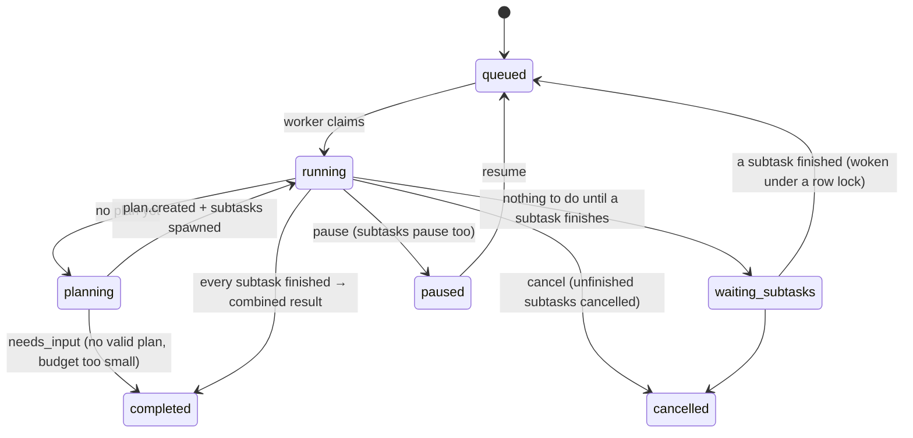

# Orchestrator

> Phase 5 · Code: `api/agentfirm/runtime/orchestrator.py` · Evals: `api/agentfirm/evals/orchestrator.yaml` (12 cases) ·
> Decision record: [ADR 0005](../adr/0005-orchestrator.md)

The orchestrator turns one request into coordinated work across agents. **It is not an agent:** it has no
manifest, no tools and no approvals of its own. It plans, starts subtasks, passes results between them,
follows agent handoffs and writes the combined answer. Every action happens inside an agent subtask.

## When it runs

| Task created with | What happens |
|---|---|
| one agent | That agent runs directly (no orchestrator). Its handoffs are shown as suggestions. |
| several agents | The orchestrator plans across exactly those agents and must use each of them. |
| no agents | The orchestrator chooses from every agent the requester may use. |

A multi-agent task accepts only a task budget (`max_credits`, 1–5,000, default 1,500). Agent-specific
parameters need a single-agent task.

## Lifecycle

Each turn: acknowledge finished subtasks (`subtask.completed`), follow their handoffs, release blocked
subtasks whose dependencies finished (or skip them), then either combine the results or go idle.

## Planning

1. **Candidates:** agents with a current version that accept work from `orchestrator`, whose required
   permissions the requester holds, limited to the user's selection if there is one.
2. **Plan** (`reasoning` model route): `{subtasks: [{key, agent, intent?, objective, depends_on}], rationale}`,
   at most 6 subtasks. The prompt asks for the fewest subtasks, self-contained objectives, direct routing
   to specialists and **no actions the user didn't ask for**.
3. **Validation** (`validate_plan`, unit-tested): unique keys, known agents, valid intents, known
   dependencies, no cycles, every selected agent used. One repair attempt with the errors; then the task
   ends with `needs_input`.
4. **Budget** (`allot`): the task budget minus 60 credits for the orchestrator, split evenly, capped by each
   agent's own `max_credits`. Any slice below 20 credits → `needs_input` ("raise max_credits").
5. The plan is persisted (`plan.created`, `kind: orchestration`) **before** subtasks are created, with each
   agent version pinned.

## Running subtasks

- A subtask is an ordinary agent execution (same engine, checkpoints, approvals, budgets) with its own
  objective. If the plan named an intent it is used; otherwise the agent classifies its objective itself.
- **Dependencies:** a `blocked` subtask is released when all its dependencies finished as `completed` or
  `partial`. It receives their results as `upstream` context. If a dependency failed, was cancelled or
  skipped, or **needs input**, the subtask is `skipped` with the reason, and so are its dependents.
  Independent subtasks are unaffected.
- **Upstream results** (summary, claims with status, artifact names) are injected into the agent's model
  prompts inside per-agent `<untrusted>` blocks. The security preamble tells models never to follow them.
- **Handoffs** from a finished subtask become new subtasks when all of these hold: the source completed or
  was partial; source `can_delegate_to` and target `accepts_from` allow it; the requester may use the
  target (and the user selected it, if they selected agents); depth ≤ source `max_delegation_depth`
  (cap 2); not back to the source or its delegator; fewer than 10 subtasks; at least 20 credits left; not
  a duplicate. Otherwise a `handoff` event records `declined_because`, and the request is offered in the
  result as a suggested next step.

## Approvals across agents

- The orchestrator never calls tools and never decides approvals.
- Approval requests belong to one subtask execution; an approval for one subtask authorises nothing in
  another. The approver's authority rules (ADR 0004) apply unchanged.
- The task shows **Needs approval** while any subtask waits for one; the orchestrator sleeps meanwhile.
- Nothing an upstream agent writes can approve, publish or widen permissions: it is data for the next
  agent's model, and the next agent's tools still go through grants, permissions and approval gates.

## Result

- **One subtask:** that subtask's result, with the task's total credits.
- **Several:** a short overview (`summarize` route, built only from the results; on failure a fixed
  sentence), then "What each agent did" with each subtask's full summary and outcome. Claims (with their
  statuses and citations) and artifacts are merged; refused handoffs become `handoffs` suggestions.
- **Status:** `completed` if every subtask completed; `needs_input` if any needs input (questions prefixed
  with the agent); `failed` if all failed or were skipped; otherwise `partial`.

## Durability and concurrency

- **Crash safety:** the plan is persisted first; subtasks have unique `(orchestrator, key)`, so replaying a
  turn creates nothing twice (tested).
- **No lost wake-ups:** a finishing subtask updates its status and re-queues a `waiting_subtasks`
  orchestrator in one transaction, under a lock on the orchestrator row. The orchestrator re-checks its
  subtasks under that lock before going idle (tested with the race forced).
- **SSE:** the task stream ends only on the orchestrator's terminal event, not a subtask's.

## Simulated mode

With `AGENTFIRM_GATEWAY_MODE=simulated`, planning uses a deterministic clause router: split on sentence
breaks, "then" and "also", route each clause by leading verb and intent examples, chain "then" clauses
and run "also" clauses in parallel. It proves the coordination machinery in CI and evals; it says nothing
about planning quality, which the rubric items and live-model evals measure.

## Known limits

- Plans are made once; the orchestrator doesn't re-plan after a failure (the user can retry).
- A subtask that "completes" without useful output (e.g. Research finding no sources) still releases its
  dependents. The approval preview is where a person catches a weak post; see ARCHITECTURE R-23.
- Answering a subtask's question doesn't resume the task yet; the user starts a new task.
